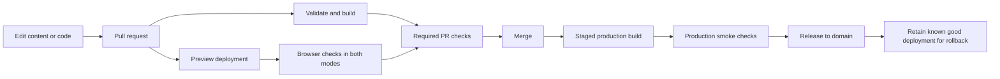

# Portfolio rebuild: professional default, optional F1 mode

Date: 2026-10-17. Status: approved by owner; implementation exists and is under final validation. See CHECKPOINT.md for current evidence.

Local review copy. Accepted implementation work belongs in the repository's GitHub issue tracker under its existing conventions. No issue has been published. Independent read-only builder checks completed on 2026-10-17, including the revised cinematic transition: no important unanswered planning questions identified. The owner's framework/design review is still pending.

## 1. Intent and decisions

Build a hiring-focused portfolio that lets a recruiter understand Adeel's focus, inspect evidence of his work, open his resume, and contact him quickly. It should also reward an engineer who wants to read architecture, trade-offs, and evaluation details. Adding a project or credential should be a content edit followed by the normal preview/release workflow.

**Owner-selected requirements:**

- A professional, minimal corporate presentation by default, inspired by the restraint of Apple, NVIDIA, and Microsoft websites.
- A visible button changes the site to a refined F1 theme.
- A spectacular short transition into F1 mode may use heavier effects. Research GitHub, Three.js, 21st.dev and relevant animation resources. No design preview/mockup is wanted.
- Projects and certifications are edited in simple files in Git, with automatic previews and deployment.
- Address broken UI/UX, propose creative improvements, and choose a maintainable framework and CI/CD approach.

**Recommendations made by Codex, still open to review:**

- Astro with TypeScript, prerendered content pages, Markdown content collections, CSS theme tokens, and small scripts for interaction. React is optional for a future interactive demo, not a dependency required by the theme switch.
- One site, one content model, one set of URLs, and one shared component structure. Both modes show the same professional claims and actions.
- Professional mode is light by default; F1 mode is dark. These are two designed modes, not an additional independent light/dark preference matrix.
- A custom 2.2-second Lights Out transition uses an optional Three.js scene, GSAP timeline and CSS/SVG reveal. Its dependency chunk loads on theme-switch intent. Exact choreography is specified below; no animation has been built or benchmarked.
- Vercel is the initial deployment target proposed from the repository's existing deployment guidance. Actual hosting/project configuration has not been inspected. Keep content and rendering portable; isolate the small server route behind an adapter.
- No new CMS, database, authentication service, contact-form service, or AI chatbot in the first release. Email and professional links already satisfy contact needs.

The owner approved this design and explicitly requested implementation. Astro is the active application. Original user edits and legacy source are preserved; the checkpoint records the current branch and verification state.

## 2. What the audit establishes

The source audit ran on 2026-10-14. On 2026-10-17, HEAD, branch, changed-file list, diff statistics, and the layout/profile diffs were checked against the checkpoint. No application edit was made during this assessment.

| Finding | Evidence | Required response |
| --- | --- | --- |
| Current app does not compile | Duplicate `<html>` opening and duplicate body `className` in `app/layout.tsx:64`; typecheck, lint, build failed | Restore a compiling baseline as the first implementation step, preserving the intended overflow styling and other existing edits |
| 37 unit tests passed while the UI build failed | Three Node test files cover content and pure logic | Retain useful unit coverage; add browser coverage for actual visitor journeys |
| Project records lack demo/repository fields | `data/projects.ts:33` and `components/sections/projects/project-row.tsx` | Add explicit evidence links and a dedicated case-study page per published project |
| Certifications are strings mixed with activities | `data/education.ts:15` | Separate verified credentials, education, and activities; introduce structured fields |
| Navigation relies on JS and hidden labels | `components/nav/animated-tab-bar.tsx`, `nav-dock.tsx`, `lib/hooks/use-preloader-done.ts` | Use visible text links that work before JavaScript; make mobile navigation readable |
| Project summary forces internal horizontal scrolling | `components/sections/projects/index.tsx:29` uses `min-w-[36rem]` | Use stacked mobile project summaries, without requiring sideways scrolling |
| Decorative charts resemble real telemetry | `telemetry-panel.tsx:15` generates sine waves; line 57 displays REC | Prefer actual screenshots, labelled architecture diagrams, and sourced measurements |
| Accessibility gaps in source | `maximumScale: 1` in layout; missing h2 headings in several sections | Permit zoom, restore heading structure, include skip link and visible keyboard focus |
| Preloader adds a content gate | `spatial-neural-preloader.tsx` and global preloader styles | Show the portfolio immediately in both modes |

These are source and command findings. The current UI has not been inspected in a working browser because it does not compile. Contrast, screenshots, mobile overflow, live deployment behavior, and Core Web Vitals have not been measured. Existing project metrics are unverified claims until their evidence is supplied.

Useful foundations to preserve: separated content and rendering, TypeScript contracts, the public resume URL, guarded storage helpers, contribution-data parsing tests, and the current CI verification sequence.

## 3. Framework decision

**Recommendation: retain TypeScript and rebuild in Astro.** The task is predominantly content delivery with a small amount of interaction. Changing programming language will not repair layout, navigation, or evidence quality. Astro is a better fit for the proposed operating model, rather than a cure for the existing bugs.

| Option | Fit and benefit | Cost and limitation | Verdict |
| --- | --- | --- | --- |
| Astro + TypeScript | Static content, schema-validated Markdown, selective client scripts; optional React islands | Rewrite Next-specific layout, images, fonts, metadata and route handling; new framework conventions | Preferred for the requested full rebuild |
| Upgrade Next.js + TypeScript | Most reuse of current components, helpers and route; useful if app-like features become central | Still requires the UI/content redesign; broad motion/provider machinery should be simplified | Best if minimizing migration effort is the priority |
| SvelteKit + TypeScript | Suitable for a strongly interactive application, with prerendering available | Rewrite components and state in another UI model; little reuse or unique benefit for this scope | Viable, but no compelling reason to choose it here |

Astro renders most content as HTML and hydrates interactive islands selectively. Its content collections support structured entries and schemas. These capabilities support this recommendation; no measured speed or hosting-cost advantage is claimed for the unbuilt site. [Astro islands](https://docs.astro.build/en/concepts/islands/), [content collections](https://docs.astro.build/en/guides/content-collections/).

The existing Next 14.2.5 line is listed as unsupported in the current policy; staying on Next requires an upgrade, not just restyling. [Next.js support policy](https://nextjs.org/support-policy).

Select compatible stable package versions at implementation time and lock them. Align local development, CI and deployment on Node 24 LTS if supported by the selected versions; record the version in the repository. The current local Node 21 / CI Node 20 mismatch should not carry forward. [Node releases](https://nodejs.org/en/about/previous-releases).

### Rendering and compatibility boundary

Prerender the home page, project index, project case studies, credentials, and about page. Use the official hosting adapter only for the retained `/api/contributions` endpoint. This makes the core portfolio static while acknowledging that the complete site is not a pure static export. Astro permits individual routes to render on demand. [Astro on-demand rendering](https://docs.astro.build/en/guides/on-demand-rendering/), [Vercel adapter](https://docs.astro.build/en/guides/integrations-guide/vercel/).

Preserve the route's observable contract: GET, JSON `{ contributions: [...] }`, status 200 including `{ contributions: [] }` on upstream failure, five-second upstream timeout, optional `level`, and `Cache-Control: public, s-maxage=3600, stale-while-revalidate`. Extract Next-specific fetch caching from the pure parser. Use route/CDN caching on Vercel; do not claim a process-local cache provides a shared serverless cache. Document that this replaces Next's additional data cache, and test the response and failure behavior. The public pages must not wait on this service. The activity graph is optional and not part of the primary home-page story.

Preserve `/resume.pdf` and only render resume actions when the file is available. Preserve old hash targets (`hero`, `about`, `projects`, `garage`, `contact`, and `project-01` through `project-03`) as meaningful landing targets on the new home page; URL fragments cannot be fixed by server redirects. Keep the legacy `garage` anchor at the skills/credentials summary. Migrate metadata, favicon, OG image, canonical origin, 404 behavior and asset paths explicitly.

## 4. The two visual modes

| Element | Professional default | Refined F1 mode |
| --- | --- | --- |
| Canvas | Warm white, graphite text, quiet grey divisions | Ink/navy canvas, pale text, subtle track-grid detailing |
| Accent | One restrained blue for primary actions | Red for actions, yellow for a small amount of verified measurement emphasis |
| Typography | Clear sans-serif, generous spacing, strong hierarchy | Same readable body face; monospace for indexes and small labels |
| Projects | Large product image, concise summary, clear evidence links | Same geometry with numbered project markers and instrument-panel borders |
| Navigation | Home, Projects, Credentials, About, Contact | Same words and destinations, with optional racing symbols as decoration |
| Motion | Brief feedback on interaction | A user-triggered cinematic entrance, then restrained interaction feedback and a still reading experience |

The inspiration is presentation discipline: a clear proposition, precise spacing, good imagery, and restrained color. Do not reuse company logos, copy their layouts, imply affiliation, or turn the site into a collection of generic glowing cards.

### Theme switch behavior

- A visible header button labelled `F1 mode`, with `aria-pressed`, works by keyboard and touch. Pressing it again returns to Professional mode. No hidden gesture or terminal command is necessary.
- Apply a root `data-theme` value; shared semantic tokens control colors, borders, shadows and decorative accents. Shared components and content avoid maintaining two sites.
- Preserve route, hash, scroll position, focus, expanded content and project filters during a switch. Do not remount the page or change major layout geometry.
- Save only a validated theme preference in guarded browser storage. A tiny pre-paint initialization script reads it before styling; invalid/unavailable storage falls back to Professional. Content is never hidden while initialization runs.
- With JavaScript disabled, Professional mode, content, links and contact remain usable. Hide the nonfunctional switch until its handler is installed.
- Use the cinematic entrance below only on explicit Professional-to-F1 activation. Restoring a saved mode, loading a page or following normal navigation never runs it. No startup preloader or artificial delay before reading content.
- Return to Professional with a 450 ms retracting sweep. Reduced motion uses an immediate change or <=150 ms fade, skips depth/zoom/countdown, and does not import the optional effect. A live reduced-motion change cancels an active cinematic.
- Load the heavier effect on theme-switch intent and dispose its renderer/resources when the transition ends, even though F1 mode remains selected. No persistent animation loop is required by the settled F1 theme.
- Printing uses a simple light presentation regardless of selected mode.

### Lights Out entrance

The owner permits a heavier short effect; the following choreography is Codex's recommendation. Detailed sources, lifecycle and acceptance cases are in [F1 transition research](../../research/2026-10-17-f1-transition.md).

| Time from activation | Visual beat |
| --- | --- |
| 0-120 ms | Immediate control feedback; a precise red line extends into a dark viewport cover. |
| 120-650 ms | Five small starting lights illuminate, hold briefly, then turn off together. No strobing or full-screen flash. |
| 650-1550 ms | A low track-level perspective accelerates through red/white curbs and stretched light trails, with a controlled field-of-view change and stable horizon. |
| 1550-2200 ms | A track-edge sweep reveals the real portfolio in F1 mode; decorative details settle and the temporary scene is disposed. |

Three.js provides the procedural track and instanced trails; GSAP coordinates a single timeline; CSS/SVG provides the cover and fallback. Use [React Bits Hyperspeed source](https://github.com/DavidHDev/react-bits/blob/310fc737fadcaa149a4e06fb088fc95332dc8bfb/src/ts-default/Backgrounds/Hyperspeed/Hyperspeed.tsx), [21st.dev Shader Reveal Transition](https://21st.dev/@educalvolpz/components/shader-reveal-transition), and [Codrops light-trail techniques](https://tympanus.net/codrops/2019/11/13/high-speed-light-trails-in-three-js/) as references, not unreviewed drop-in dependencies. The research records individual licenses and inspection limits.

The sequence stays silent, with one main acceleration beat and a calm finish. No external car model or video is required. Do not animate every text block after the reveal. The existing page is covered while its theme tokens change, then uncovered; no page capture, cloned interactive tree or route remount is required. This scene can run with Astro or Next.js and does not force a React dependency in Astro.

Start module loading on deliberate hover/focus/pointer-down on the switch, subject to reduced motion. On activation, respond immediately and prepare the scene during the lights beat. If import and shader preparation are not ready within a provisional 500 ms, finish using the CSS racing sweep by approximately 700 ms. Late asynchronous work must dispose itself without replaying or changing the final theme. The rich path targets 2.2 seconds and settles at the next execution opportunity if its 2.5-second foreground deadline is exceeded.

Use one session/controller with a latest-request-wins policy. Completion, failure, Escape/Skip, navigation, hidden page, context loss and preference changes share an idempotent cleanup path. The decorative overlay is aria-hidden, while the mode and Skip controls remain visible, focusable siblings. Tab or scroll intent finishes the effect before the ordinary interaction proceeds. Preserve focus, scroll and UI state; release transient listeners, timers, animation loops and GPU resources on every exit. Precise input/focus cases are specified in the research companion.

## 5. Information architecture and page layout

| Route | Visitor task | Content |
| --- | --- | --- |
| `/` | Understand the person and choose the next step | Proposition, featured projects, capabilities linked to evidence, credential summary, short about block, contact |
| `/projects/` | Browse all published work | Compact summaries, optional category filter, clear build status and evidence links |
| `/projects/[slug]/` | Evaluate one project deeply | Problem, role, solution, architecture, measured results, trade-offs, limitations, next steps |
| `/certifications/` | Check credentials | Issuer, exact title, issue/expiry dates, verification and related work |
| `/about/` | Understand background | Short narrative, education, dated experience/activities when supplied, current focus, resume/contact |

The home page opens with name, role and a concrete one-sentence proposition. Suggested copy direction: “I build AI systems people can use.” Supporting copy specifies backend, retrieval and applied ML work without claiming unsupported production results. Primary action: View projects. Secondary action: Resume. Contact is visible in the header/footer.

Show selected work immediately after the introduction. Prefer two or three strong case studies to a long wall of technology badges. Each summary answers what the project does, what Adeel contributed, and where the evidence is. Put detailed biography after the work.

Use a centered reading grid with a maximum content width around 1200 px, generous desktop whitespace, body text around 16-18 px, and a readable article measure. Final fonts, exact color values and spacing are builder decisions subject to contrast and visual review. On phones, content becomes one column; use a small accessible menu for labelled navigation, retain the theme button, and avoid a permanent bottom dock covering content. Aim for 44 px touch areas and clear focus indicators.

## 6. Git-managed content

Use one Markdown file per project and credential, with frontmatter for structured fields. Plain Markdown is the default; add MDX only when a case study genuinely needs an embedded component. YAML/JSON can hold profile and skill records. Schemas validate content at build time. This is a proposed layout:

```text
src/content/projects/<slug>.md
src/content/certifications/<slug>.md
src/data/profile.json
src/data/skills.json
src/data/education.json
src/data/activities.json
src/assets/projects/<slug>/...
public/resume.pdf
```

### Project fields

Required for a published project: stable `slug`, `title`, `summary`, two-part `description` (`what it is`, `how it works`), `role`, `status` (`in-progress`, `completed`, `archived`), `category`, `skills`, `startedAt`, `updatedAt`, and `draft`. Optional: `completedAt`, `featuredOrder`, team context, repository URL, live URL, video URL and media with alt text.

Each metric is an object containing `value`, `label`, `method`, `measuredAt`, and an evidence URL or local evidence reference. Unsupported metrics stay in draft notes and are not displayed publicly. “Live demo” is rendered only when a valid URL exists; omit absent actions rather than creating empty buttons. Evidence can also be screenshots, a reproducible evaluation or architecture notes when a private repository cannot be shared.

Case-study body uses stable sections: Problem -> My contribution -> Approach -> Architecture -> Evaluation -> Trade-offs and limitations -> Next steps. Keep the current two-part summary contract while adding this richer body.

### Certification fields

Required: `slug`, exact `title`, `issuer`, `kind` (`certification`, `course-completion`, `badge`), `issuedAt`, `skills`, and `draft`. Optional: `expiresAt`, `credentialId`, `verificationUrl`, certificate image/PDF, and `relatedProjects`.

Display credential kind accurately. A course completion is not automatically a professional certification. A credential without a verification link can still appear if the owner supplies sufficient details, but it must not show a “Verified” badge. Expired credentials are labelled. In-progress study belongs in activities/current learning, not completed credentials. General open-source activity and hackathon participation are separate records. Never invent dates, credential IDs, issuers, badges or qualification status.

### Publishing rules

- Draft entries are excluded from public routes, indexes, feeds, search data and sitemap. Preview deployments use the same publication filter by default; inspecting an unpublished draft requires a deliberate later feature, not an environment-variable leak.
- CI rejects duplicate slugs, invalid dates/URLs, missing referenced assets, unknown skill/project references, and published metrics without evidence context.
- If no confirmed credentials exist, omit the home-page credential summary and keep the credentials page factual and sparse. Do not fill it with fabricated examples.
- Adding the next entry should require only the content file and its media. No component edits should be required.
- Content templates in documentation explain required fields and preview commands. Author edits -> PR -> preview -> checks -> merge -> gated deployment.

## 7. Creative ideas, ordered by value

### Include in the first release

1. **Evidence-led project cards.** A real screenshot plus a one-line result, clear personal contribution, and Read case study / Code / Demo actions where evidence exists.
2. **Skills connected to work.** Selecting a skill reveals relevant projects and credentials. No percentages or ungrounded proficiency meters. All projects remain accessible without filtering.
3. **The F1 transformation.** The Lights Out entrance is the signature interaction: a brief racing sequence followed by a clear portfolio. Keep navigation and project language understandable to visitors unfamiliar with motorsport.
4. **A useful project debrief.** Include one decision that changed, one limitation, and one thing learned in each case study. This gives interviewers something concrete to discuss.

### Add after the portfolio is stable

- A compact “Now” entry with an explicit update date, maintained in Git.
- Short engineering notes derived from real debugging/evaluation work; add a notes collection and routes only when there is publishable content.
- A user-triggered demo within a case study, with a static explanation available before it loads. Choose a bounded recorded/reproducible demonstration before adding an ongoing inference service.

### Project-development ideas, not claims of existing completion

| Direction | Why it helps | Publishable evidence to aim for |
| --- | --- | --- |
| Deepen SEFGH's retrieval evaluation | Strengthens an existing flagship project | Versioned query set, baseline vs improved ranking, failure analysis, measured latency methodology |
| Outcome Verifier, scoped to a few integrations | Demonstrates backend reliability and agent evaluation | Deterministic flaky fixtures, explicit state machine, retry/idempotency tests, audit trail and reproducible demo |
| Finish campus360-api as a coherent backend | Demonstrates engineering fundamentals | OpenAPI documentation, auth boundaries, migration/seed workflow, tests and CI evidence |

These directions come from project context, not a fresh verification of those repositories. Start by finishing one coherent project and documenting it well. Keep the existing palm-tree detection and drone work only with accurate role, implementation status and evidence. The portfolio rebuild adds room for future work; it does not fabricate or implement these separate projects.

## 8. Flexible CI/CD

Keep npm and the lockfile unless implementation uncovers a concrete reason to change. Define stable scripts for type/content checks, lint, unit tests, build and browser tests. CI runs on PRs and the production branch, with concurrency cancellation, explicit timeouts and least required permissions.



Recommended first target: GitHub Actions for checks, Vercel Git integration for previews/builds, protected `main`, and Deployment Checks that hold production-domain assignment until required checks pass. Preview success alone does not prove the production build passed. Verify exact project, commit, environment, allowed CI access and available checks during setup. Vercel documents holding production releases behind required checks. [Deployment Checks](https://vercel.com/docs/deployment-checks), [GitHub branch protection](https://docs.github.com/en/repositories/configuring-branches-and-merges-in-your-repository/managing-protected-branches/about-protected-branches).

If that release gate is unavailable in the intended project, use a single CI-owned deployment path: build and stage production without assigning the domain, smoke-test that deployment, then promote it. Avoid two independent systems both releasing production. Verify the provider's current CLI and plan behavior before implementing either path.

Separate local development, preview and production settings. Keep credentials in the provider/CI secret store. Untrusted PRs must not receive deployment secrets. Capture the commit SHA and test results for each release. Schedule external-link checks separately so a temporary external outage does not randomly block ordinary content edits; internal links and missing files remain required checks.

Keep content portable and isolate hosting-specific route/cache configuration. A move to another provider should change the adapter/deploy configuration and revalidate API/redirect behavior, rather than requiring a content rewrite. No automatic live connection, release or hosting migration is part of this design document.

The Vercel CLI is not installed in the session environment. Recommend `npm i -g vercel` for local deployment/env/log tooling when implementation starts; use a reviewed pinned version in CI. [Vercel CLI](https://vercel.com/docs/cli).

## 9. Acceptance criteria

- Professional is the default for a new visitor. Both modes work on 320, 390, 768 and 1440 px viewport widths and at 200% zoom; no page-level horizontal overflow or obscured primary actions.
- Keyboard users can reach navigation, theme switch, project actions, resume and contact. Focus stays visible. Headings and landmarks are meaningful. Main content works without JS.
- Theme preference persists across reload and page navigation; blocked storage and reduced motion are covered. Switching does not lose scroll, focus or filter state.
- The cinematic runs only on explicit entry into F1 mode. Verify cold/warm loads, fallback, interrupted and repeated switches, live reduced motion, keyboard/Skip behavior and renderer cleanup. After settling there is no effect canvas or ongoing effect animation loop. Profile frame times on representative devices; no smoothness claim is made before measurement.
- Browser checks cover Chrome, Firefox and WebKit for core flows; run the full mode/viewport screenshot matrix on an appropriate consistent browser runner. Screenshots are visually reviewed, not accepted merely because a file exists.
- Automated accessibility checks cover both themes; manually verify keyboard, zoom, contrast and responsive reading. Automation is not a complete accessibility certification.
- Each published project has a real case study and usable evidence. Credential fields and links are accurate. All local assets, hash targets, PDF and canonical URLs resolve correctly.
- Contribution API handles valid payloads, malformed upstream JSON, timeout and non-OK upstream responses with the preserved contract. An optional service failure does not break content or build.
- Typecheck/content validation, lint, meaningful unit tests and production build pass. Browser tests exercise navigation, both modes, filters, deep links and resume availability.
- Set a provisional first-load JS budget of 75 KB gzip for the home page, excluding the separately loaded cinematic and optional user-triggered demos. Report core and effect-chunk bytes separately, check that no heavy effect import is on the arrival path, and measure cold/warm switch readiness. Measure and report if a budget needs revision. Avoid autoplay video and reserve image dimensions.
- Target good Core Web Vitals: LCP <=2.5 s, INP <=200 ms, CLS <=0.1 at the 75th percentile when enough field data exists. Before launch, report lab measurements as lab measurements; do not claim field performance from Lighthouse alone. [Web Vitals](https://web.dev/articles/vitals).

## 10. Delivery checkpoints and remaining dependencies

1. Design reviewed and framework selected; update the shared architecture guidance to reflect the accepted choice.
2. Restore a working baseline and establish a safe migration branch/snapshot that includes intended existing user edits. Do not reset, stash or silently discard the dirty checkout.
3. Implement the content schemas and professional layout, then the F1 mode using the same components and the bounded Lights Out transition. Preserve the contracts listed above.
4. Fill published content with verified facts/media; complete both-mode interaction and accessibility checks.
5. Configure preview and production gates on the confirmed hosting project; validate rollback and release behavior before cutover.

The detailed implementation plan follows design review. This outline is not a claim that those stages have been implemented.

Dependencies on the owner: review the Astro choice and written design; provide or confirm real credential details, project media/URLs and evidence for numerical claims. Existing content can be migrated as draft while evidence is resolved. Hosting identity/permissions and production-domain ownership must be confirmed during deployment setup, rather than inferred from README guidance.

The owner declined the design preview/mockup on 2026-10-17; do not create one. This does not remove automatic Git deployment previews from the publishing workflow. No visual prototype is claimed. No application code, dependencies, workflow, external service or live deployment has changed in this design phase.
